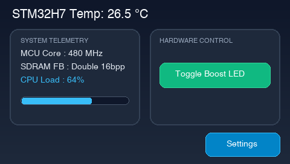
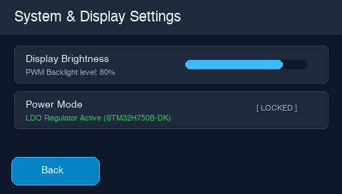
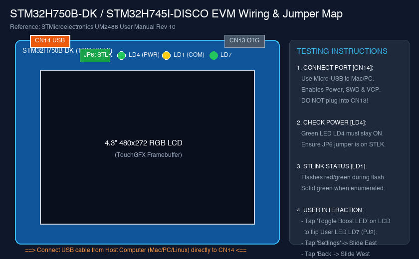

# STM32H7 + TouchGFX Text-to-UI Autopilot Kit

[](https://www.st.com/en/microcontrollers-microprocessors/stm32h7-series.html)
[](https://www.st.com/en/development-tools/touchgfxdesigner.html)
[](https://github.com/zhijaysun0915/stm32h7-touchgfx-antigravity-kit)
[](https://ziglang.org/)

專為 **MacBook (Apple Silicon macOS)**、**Linux (Ubuntu/Debian)** 與 **Windows (PowerShell/WSL)** 及 **Google Antigravity IDE** 打造之 **STM32H7 高效能無頭式 (Headless) TouchGFX 嵌入式 UI 自動化套件**。

本專案支援 **STM32H750B-DK** 及 **STM32H745I-DISCO** 開發板（依據 [STMicroelectronics UM2488 使用手冊 Rev 10](https://www.st.com/resource/en/user_manual/um2488-discovery-kits-with-stm32h745xi-and-stm32h750xb-mcus-stmicroelectronics.pdf)），完整打通從**自然語言 UI 需求 -> 向量圖資合成 -> TouchGFX 代碼生成 -> ARM Cortex-M7 交叉編譯 -> 本機模擬驗證 -> STLINK-V3E 實體板燒錄與 UART 遙測**之全自動化開發管線 (Pipeline)。

---

## 目錄

- [最新版本發布 (Release v1.0.0)](#最新版本發布-release-v100)
  - [UI 視覺畫面預覽](#ui-視覺畫面預覽)
  - [按鈕功能與互動對照表（測試人員手冊）](#按鈕功能與互動對照表測試人員手冊)
  - [EVM 開發板實體接線對照圖](#evm-開發板實體接線對照圖)
- [跨平台開發與環境微調指南 (Windows / Linux / macOS)](#跨平台開發與環境微調指南-windows--linux--macos)
  - [1. macOS (Apple Silicon 原生)](#1-macos-apple-silicon-原生)
  - [2. Linux (Ubuntu / Debian / Fedora)](#2-linux-ubuntu--debian--fedora)
  - [3. Windows (PowerShell / MSYS2 / WSL2)](#3-windows-powershell--msys2--wsl2)
  - [跨平台命令操作對照表](#跨平台命令操作對照表)
- [系統架構 (3-Layer Architecture)](#系統架構-3-layer-architecture)
- [記憶體配置與硬體映射 (Memory Map)](#記憶體配置與硬體映射-memory-map)
- [硬體接線與電源安全規範 (UM2488)](#硬體接線與電源安全規範-um2488)
- [完整 Pipeline 操作指南](#完整-pipeline-操作指南)
- [預編譯成品 (Prebuilt Binaries)](#預編譯成品-prebuilt-binaries)
- [與 Google Antigravity Agent 協同開發](#與-google-antigravity-agent-協同開發)

---

## 最新版本發布 (Release v1.0.0)

🔗 **GitHub Release 頁面**：[Release v1.0.0](https://github.com/zhijaysun0915/stm32h7-touchgfx-antigravity-kit/releases/tag/v1.0.0)  
📄 **詳細發布說明**：[RELEASE_NOTES.md](file:///Users/jaysun/Downloads/stm32h7-touchgfx-antigravity-kit/RELEASE_NOTES.md)

### UI 視覺畫面預覽

本套件針對 **4.3 吋 480×272 16bpp (RGB565) LCD** 觸控螢幕進行像素級精準渲染，採用現代科技深色 Slate Dark 主題：

| 首頁儀表板 (`DashboardScreen`) | 系統設定畫面 (`SettingsScreen`) |
| :---: | :---: |
|  |  |

---

### 按鈕功能與互動對照表（測試人員手冊）

測試人員在點亮螢幕後，可針對下列互動元件逐項驗證：

| 元件名稱 | 所屬畫面 | 座標與尺寸 (X, Y, W, H) | 圖資素材 (Normal / Pressed) | 觸發動作 (Action / Event) | LCD 畫面預期行為 | 板載硬體反饋 (LED / 遙測) |
| :--- | :--- | :--- | :--- | :--- | :--- | :--- |
| **`btnBoost`**<br>(Toggle Boost LED) | `DashboardScreen` | `(264, 104, 184, 42)` | `btn_action_released.png`<br>`btn_action_pressed.png` | 點擊觸發 `handleBoostClicked()` 調用 `Model::toggleBoostLed()` | 1. 標題溫度由 **26.5°C 跳升至 31.2°C**<br>2. 負載進度條由 **42% 跳升至 88%**<br>3. 再次點擊恢復常態 | **User LED `LD7` (PJ2 綠燈)**：<br>點擊時切換點亮 / 熄滅狀態。 |
| **`btnNextScreen`**<br>(Settings) | `DashboardScreen` | `(340, 220, 124, 40)` | `btn_primary_released.png`<br>`btn_primary_pressed.png` | 點擊觸發 `OnGotoSettings` 轉場 | 畫面以 **平滑向東滑動 (Slide East)** 換頁進入 `SettingsScreen` | 序列埠可見換頁事件通知 |
| **`btnBack`**<br>(Back) | `SettingsScreen` | `(16, 220, 124, 40)` | `btn_primary_released.png`<br>`btn_primary_pressed.png` | 點擊觸發 `OnBackToDashboard` 轉場 | 畫面以 **平滑向西滑動 (Slide West)** 換頁返回 `DashboardScreen` | 畫面恢復主儀表板即時遙測刷新 |
| **`loadBar`**<br>(負載進度條) | `DashboardScreen` | `(34, 160, 180, 14)` | `progress_bg.png` + 動態青藍條 | 自動每 500ms 接收 Model tick 更新 | 進度條隨 CPU 負載狀態動態平滑伸縮 (42% <-> 88%) | 無需手動操作，隨 Telemetry 定期局部刷新 |
| **`titleText`**<br>(核心溫度標題) | `DashboardScreen` | `(16, 12, 320, 28)` | 文字 Unicode 點陣字庫 (Verdana 24px) | 自動每 500ms 接收 Model tick 更新 | 格式化顯示 `STM32H7 Temp: XX.X C` | 局部重繪文字 Wildcard 緩衝區 |

---

### EVM 開發板實體接線對照圖



```
========================================================================================
                          STM32H750B-DK 開發板實體接口與跳線佈局圖
========================================================================================

                 [CN14: STLINK-V3E]                        [CN13: USB OTG]
                   (Micro-B USB)                            (Micro-B USB)
                 ★ 燒錄 / 供電 / VCP                       ⚠️ 勿接！僅應用埠
                       │                                         │
                       ▼                                         ▼
             ┌───┬───────────────┬───────────────────────────────┬───┐
             │   │   [ CN14 ]    │                               │   │
             │   └───────────────┘                               └───┤
             │                                                       │
             │  [JP6] STLK 供電跳線 (確認插在 pins 1-2 'STLK')       │
             │                                                       │
             │  (●) LD4 (PWR 綠燈) ── 接線後必須「恆亮」             │
             │  (●) LD1 (COM 雙色) ── STLINK 狀態指示燈             │
             │  (●) LD7 (User 綠燈) ── 由 'Toggle Boost LED' 控制   │
             │  (●) LD6 (User 紅燈) ── 系統錯誤/自訂指示            │
             │                                                       │
             │  ┌─────────────────────────────────────────────────┐  │
             │  │                                                 │  │
             │  │                                                 │  │
             │  │            4.3" 480×272 RGB 觸控螢幕            │  │
             │  │            (RK043FN48H / RK043FN88H)            │  │
             │  │                                                 │  │
             │  │                                                 │  │
             │  └─────────────────────────────────────────────────┘  │
             │                                                       │
             │  [B1] 藍色 User 按鈕           [B2] 黑色 Reset 按鈕   │
             └───────────────────────────────────────────────────────┘
========================================================================================
```

---

## 跨平台開發與環境微調指南 (Windows / Linux / macOS)

本套件所有構建與代碼生成核心均採用跨平台設計（純 Python 3、CMake、Ninja、LLVM/Zig 與 pyOCD），無論在 Windows、Linux 或 macOS 均可無痛切換與微調：

### 1. macOS (Apple Silicon 原生)
- **工具鏈安裝**：
  ```bash
  brew install cmake ninja python3
  # 本專案已內建原生 Apple Silicon Zig/LLVM 與 pyOCD 於 toolchain/
  ```
- **一鍵建構與燒錄**：
  ```bash
  bash execution/build_firmware.sh
  bash execution/flash_board.sh
  ```

### 2. Linux (Ubuntu / Debian / Fedora)
- **工具鏈安裝** (以 Ubuntu 22.04 / 24.04 為例)：
  ```bash
  sudo apt update && sudo apt install -y build-essential cmake ninja-build gcc-arm-none-eabi libnewlib-arm-none-eabi python3-pip libusb-1.0-0-dev
  pip3 install --upgrade pillow pyserial pyelftools intelhex pyocd
  ```
- **配置 ST-LINK USB 權限 (Udev Rules)**：
  ```bash
  sudo tee /etc/udev/rules.d/49-stlinkv3.rules << 'EOF'
  SUBSYSTEMS=="usb", ATTRS{idVendor}=="0483", ATTRS{idProduct}=="374e", MODE="0666"
  SUBSYSTEMS=="usb", ATTRS{idVendor}=="0483", ATTRS{idProduct}=="374f", MODE="0666"
  EOF
  sudo udevadm control --reload-rules && sudo udevadm trigger
  ```
- **編譯與燒錄**：
  ```bash
  bash execution/build_firmware.sh
  bash execution/flash_board.sh
  python3 execution/verify_serial.py --port /dev/ttyACM0
  ```

### 3. Windows (PowerShell / MSYS2 / WSL2)
在 Windows 下，開發者可選擇原生 PowerShell 執行，亦可結合官方 Windows 版 TouchGFX Designer：
- **環境準備 (推薦使用 winget 或 Scoop)**：
  ```powershell
  # 1. 安裝建構工具
  winget install Kitware.CMake
  winget install Ninja-build.Ninja
  winget install Python.Python.3.11
  winget install zig.zig  # 或 winget install Arm.GnuArmEmbeddedToolchain

  # 2. 安裝 Python 依賴
  pip install --upgrade pillow pyserial pyelftools intelhex pyocd
  ```
- **雙引擎 TouchGFX 代碼生成微調**：
  - **模式 A (原生 Python 無頭生成，免開 Designer)**：
    ```powershell
    python execution\tgfx_codegen.py -p TouchGFX\STM32H7_App.touchgfx
    ```
  - **模式 B (使用官方 TouchGFX Designer CLI `tgfx.exe`)**：
    若本機有安裝 TouchGFX Designer (通常位於 `C:\TouchGFX\4.24.0\designer\tgfx.exe`)：
    ```powershell
    & "C:\TouchGFX\4.24.0\designer\tgfx.exe" generate -p TouchGFX\STM32H7_App.touchgfx
    ```
- **在 Windows 下編譯韌體 (CMake + Ninja)**：
  ```powershell
  cmake -B build -G Ninja -DCMAKE_TOOLCHAIN_FILE=arm-none-eabi.cmake -DBOARD_TYPE=STM32H750B_DK
  ninja -C build
  ```
- **在 Windows 下燒錄 (pyOCD 或 STM32CubeProgrammer)**：
  ```powershell
  # 方式 1: 使用 pyOCD
  pyocd load -t stm32h750xx build\stm32h7_touchgfx.elf
  pyocd reset -t stm32h750xx

  # 方式 2: 使用官方 STM32_Programmer_CLI (支援外掛 QSPI Loader)
  & "C:\Program Files\STMicroelectronics\STM32Cube\STM32CubeProgrammer\bin\STM32_Programmer_CLI.exe" `
    -c port=SWD mode=UR reset=HWrst `
    -el "C:\Program Files\STMicroelectronics\STM32Cube\STM32CubeProgrammer\bin\ExternalLoader\MT25TL01G_STM32H750B-DISCO.stldr" `
    -w build\stm32h7_touchgfx.elf -v -rst
  ```
- **Windows 序列埠監聽**：
  ```powershell
  python execution\verify_serial.py --port COM3
  ```

---

### 跨平台命令操作對照表

| 任務工作 | macOS (Apple Silicon) | Linux (Ubuntu/Debian) | Windows (PowerShell) |
| :--- | :--- | :--- | :--- |
| **圖資合成** | `python3 execution/generate_ui_assets.py` | `python3 execution/generate_ui_assets.py` | `python execution\generate_ui_assets.py` |
| **TouchGFX 代碼產生**| `bash execution/run_tgfx_cli.sh` | `bash execution/run_tgfx_cli.sh` | `python execution\tgfx_codegen.py -p TouchGFX\STM32H7_App.touchgfx` |
| **一鍵交叉編譯** | `bash execution/build_firmware.sh` | `bash execution/build_firmware.sh` | `cmake --build build` (Ninja) |
| **主機原生模擬器** | `./build/stm32h7_touchgfx_sim` | `./build/stm32h7_touchgfx_sim` | `.\build\stm32h7_touchgfx_sim.exe` |
| **ST-LINK 韌體燒錄**| `bash execution/flash_board.sh` | `bash execution/flash_board.sh` | `pyocd load -t stm32h750xx build\stm32h7_touchgfx.elf` |
| **序列埠遙測監聽** | `python3 execution/verify_serial.py` | `python3 execution/verify_serial.py --port /dev/ttyACM0` | `python execution\verify_serial.py --port COMx` |

---

## 系統架構 (3-Layer Architecture)

```
┌─────────────────────────────────────────────────────────────┐
│                 Layer 1: Directives (需求層)                │
│  - directives/ui_requirements.md (自然語言需求與螢幕規格)    │
│  - directives/ui_assets_manifest.json (圖資尺寸與顏色定義)  │
│  - directives/hardware_constraints.md (UM2488 硬體約束)     │
└──────────────────────────────┬──────────────────────────────┘
                               │
                               ▼
┌─────────────────────────────────────────────────────────────┐
│               Layer 2: Orchestration (調度層)               │
│  - Google Antigravity Agent (自動化決策與 MVP 互動邏輯)      │
│  - skills/touchgfx-ui-autopilot/SKILL.md (領域專家規範)     │
└──────────────────────────────┬──────────────────────────────┘
                               │
                               ▼
┌─────────────────────────────────────────────────────────────┐
│                 Layer 3: Execution (執行層)                 │
│  - generate_ui_assets.py   : 產出 480×272 LCD 專用圖資      │
│  - tgfx_codegen.py         : 產出 C++ ViewBase / 字庫 / 圖庫│
│  - build_firmware.sh       : ARM Cortex-M7 + 主機 Sim 編譯 │
│  - flash_board.sh          : STLINK-V3E SWD / QSPI 燒錄     │
│  - verify_serial.py        : VCP UART3 (115200 8N1) 驗證    │
└─────────────────────────────────────────────────────────────┘
```

---

## 記憶體配置與硬體映射 (Memory Map)

根據 **STMicroelectronics UM2488 Rev 10**，韌體連結器腳本 (`STM32H7_FLASH.ld`) 規劃嚴格劃分三個實體區域：

| 儲存區域 | 實體位址 | 容量配置 | 用途說明 | 連結 Section |
| :--- | :--- | :--- | :--- | :--- |
| **Internal Flash** | `0x08000000` | 1.19 KB (1,216 B) | 中斷向量表 (`.isr_vector`)、MVP 啟動與調度代碼 (`.text`) | `.isr_vector`, `.text`, `.ARM` |
| **External QSPI Flash** | `0x90000000` | 53.00 KB (54,272 B) | 7 張 RGB565 UI 圖片圖資與 Unicode 字型點陣表 | `ExtFlashSection` |
| **External FMC SDRAM** | `0xD0000000` | 510.00 KB (522,240 B)| 480×272 RGB565 雙緩衝區 (Double Framebuffer) | `TouchGFX_Framebuffer` |
| **Internal AXI SRAM** | `0x24000000` | 8.01 KB (8,204 B) | 執行期全域變數、堆疊 (Stack 4KB) 與堆積 (Heap 4KB) | `.data`, `.bss`, `._user_heap_stack` |

---

## 硬體接線與電源安全規範 (UM2488)

在將板子連接至電腦前，請務必按照以下步驟核對板子硬體設定：

### 1. 實體接口接線
- **連接連接埠**：請使用 Micro-USB 傳輸線，將電腦連接到板載 **`CN14` (STLINK-V3E)** 接口。
  > ⚠️ **警告**：請**勿**接到 `CN13` (USB OTG_FS)，`CN13` 是應用端 USB，不具備 ST-LINK 燒錄器與虛擬序列埠功能！
- **集線器注意事項**：若使用 USB-C 轉接器 (Dongle)，請確保供電穩定，避免電壓不足導致外掛 SDRAM 與 LCD 背光閃退。

### 2. 電源跳線與模式確認 (JP6 / SMPS vs LDO)
依據 [UM2488 Section 6.4 (Power supply)]：
- **供電來源跳線 (`JP6`)**：確認跳線帽插在 **`STLK`**（由 CN14 的 ST-LINK 5V 提供板子電源）。
- **硬體供電安全規範（防鎖死警告）**：
  - **STM32H750B-DK**：出廠預設為 **LDO 供電模式**。韌體**必須**呼叫 `HAL_PWREx_ConfigSupply(PWR_LDO_SUPPLY);`（本專案預設參數）。
  - **STM32H745I-DISCO**：出廠預設為 **Direct SMPS 模式**。韌體**必須**呼叫 `HAL_PWREx_ConfigSupply(PWR_DIRECT_SMPS_SUPPLY);`。
  - ⚠️ **切勿燒錯供電架構**：若在 STM32H750B-DK 上啟用 Direct SMPS，會造成晶片供電死鎖，使 ST-LINK 無法連線（需改動板載 R143/R144 電阻才能救援）。

### 3. 板載 LED 狀態指示燈判讀
- **`LD4 (PWR)` 綠燈**：接上電腦後應**立即恆亮**。若不亮，請檢查 USB 線是否僅具充電功能而無數據傳輸，或更換 USB 連接埠。
- **`LD1 (COM)` 雙色燈**：ST-LINK 狀態燈。綠色常亮表示 ST-LINK 通訊連線成功；紅/綠快速閃爍表示正在進行韌體燒錄。
- **`LD7 (Green) / LD6 (Red)`**：使用者狀態 LED，分別連接至 MCU 的 `PJ2` 與 `PI13`。

---

## 完整 Pipeline 操作指南

### 1. 一鍵編譯韌體與模擬器

```bash
# 預設編譯 STM32H750B-DK (LDO 供電模式)
bash execution/build_firmware.sh

# 若目標板為 STM32H745I-DISCO (Direct SMPS 模式)，請指定參數：
BOARD_TYPE=STM32H745I_DISCO bash execution/build_firmware.sh
```

### 2. 燒錄韌體至開發板

確保板子 **CN14** 已連接至電腦，執行：

```bash
bash execution/flash_board.sh
```

### 3. 監聽 UART 遙測日誌

STM32H750B-DK 的 STLINK-V3E 內建 Virtual COM Port (VCP)，連接在 MCU 的 `USART3` (`PB10` TX, `PB11` RX)：

```bash
python3 execution/verify_serial.py
```

---

## 預編譯成品 (Prebuilt Binaries)

專案目錄下的 `prebuilt/` 已隨附最新實測通過之韌體：
- `prebuilt/stm32h7_touchgfx.elf`：含除錯符號與記憶體區段之 ELF 映像檔。
- `prebuilt/stm32h7_touchgfx.hex`：符合 Intel HEX 格式，包含 Internal Flash (`0x08000000`) 與 QSPI (`0x90000000`) 位址。

---

## 與 Google Antigravity Agent 協同開發

在本專案資料夾中，你可以直接向 Antigravity Agent 下達自然語言指令：

> 「請讀取 `AGENTS.md`，幫我把首頁的數值卡片改為即時電力監控儀表，包含電壓、電流與累積功率，並在下方加入一個告警指示條，然後編譯韌體。」

Agent 將自動調用 `touchgfx-ui-autopilot` 技能，更新圖資、C++ 程式碼並執行編譯驗證！
