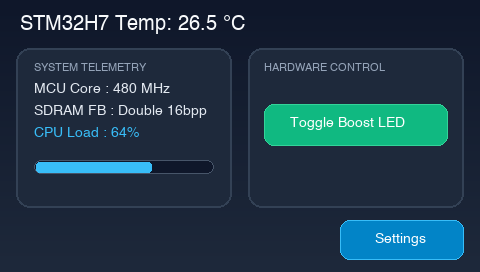
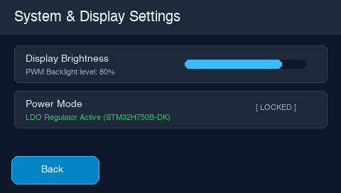
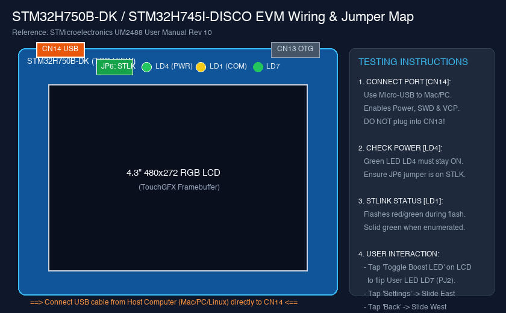

# Release v1.0.0 — STM32H7 Headless TouchGFX Text-to-UI Kit

本版本為 **STM32H750B-DK / STM32H745I-DISCO** 首個打通全自動化端到端 Pipeline 之正式發布版本。專為 Apple Silicon macOS、Linux 與 Windows 跨平台開發環境打造，達成自然語言需求到嵌入式 GUI 韌體編譯與燒錄的無頭式 (Headless) 開發體驗。

---

## 一、 UI 視覺畫面與對應元件預覽

基於 **4.3 吋 480×272 16bpp (RGB565) LCD** 觸控螢幕，採用深色現代科技風格（Slate Dark，底色 `#0F172A`）：

### 1. 首頁儀表板 (`DashboardScreen`)



- **全屏深色漸層背景**：`bg_dashboard.png` (480×272)。
- **左右雙面板佈局 (Card Panels)**：
  - **左側遙測卡片**：`leftCard` (`card_panel.png`, 216×160，半透明深藍圓角面板)。
  - **右側控制卡片**：`rightCard` (`card_panel.png`, 216×160，右側操作面板)。
- **頂部動態狀態標題 (`titleText`)**：
  - 帶 Wildcard 動態緩衝區字串：`STM32H7 Temp: <value> C`。
  - 即時格式化輸出微控制器核心溫度（預設 `26.5 °C`）。
- **系統負載動態指示條 (`loadBar`)**：
  - `BoxProgress` 元件（位置 `X=34, Y=160`，尺寸 `180×14`），底圖 `progress_bg.png`。
  - 青藍色動態指示條 (`#38BDF8`)，直觀反映 CPU / 系統負載率（0% ~ 100%）。
- **Boost 模式切換按鈕 (`btnBoost`)**：
  - 具備正常態 (`btn_action_released.png`) 與按下態 (`btn_action_pressed.png`)。
  - 標籤文字：`Toggle Boost LED`。
- **設定頁面導航按鈕 (`btnNextScreen`)**：
  - 藍色主題按鈕 (`btn_primary_released.png` / `btn_primary_pressed.png`)。
  - 標籤文字：`Settings`。

---

### 2. 系統設定畫面 (`SettingsScreen`)



- **全屏深色背景 (`settingsBg`)**：480×272 Box 元件。
- **頁面標題 (`settingsTitle`)**：`System & Display Settings`。
- **返回導航按鈕 (`btnBack`)**：
  - 位於左下角 (`X=16, Y=220`, 尺寸 `124×40`)。
  - 標籤文字：`Back`。

---

## 二、 畫面按鈕與互動功能完整對照表（測試人員操作手冊）

測試人員在點亮螢幕後，可針對下列互動元件逐項驗證：

| 元件名稱 | 所屬畫面 | 座標與尺寸 (X, Y, W, H) | 圖資素材 (Normal / Pressed) | 觸發動作 (Action / Event) | LCD 畫面預期行為 | 板載硬體反饋 (LED / 遙測) |
| :--- | :--- | :--- | :--- | :--- | :--- | :--- |
| **`btnBoost`**<br>(Toggle Boost LED) | `DashboardScreen` | `(264, 104, 184, 42)` | `btn_action_released.png`<br>`btn_action_pressed.png` | 點擊觸發 `handleBoostClicked()` 調用 `Model::toggleBoostLed()` | 1. 標題溫度由 **26.5°C 跳升至 31.2°C**<br>2. 負載進度條由 **42% 跳升至 88%**<br>3. 再次點擊恢復常態 | **User LED `LD7` (PJ2 綠燈)**：<br>點擊時切換點亮 / 熄滅狀態。 |
| **`btnNextScreen`**<br>(Settings) | `DashboardScreen` | `(340, 220, 124, 40)` | `btn_primary_released.png`<br>`btn_primary_pressed.png` | 點擊觸發 `OnGotoSettings` 轉場 | 畫面以 **平滑向東滑動 (Slide East)** 換頁進入 `SettingsScreen` | 序列埠可見畫面切換 Log |
| **`btnBack`**<br>(Back) | `SettingsScreen` | `(16, 220, 124, 40)` | `btn_primary_released.png`<br>`btn_primary_pressed.png` | 點擊觸發 `OnBackToDashboard` 轉場 | 畫面以 **平滑向西滑動 (Slide West)** 換頁返回 `DashboardScreen` | 畫面恢復主儀表板即時遙測刷新 |
| **`loadBar`**<br>(系統負載指示條) | `DashboardScreen` | `(34, 160, 180, 14)` | `progress_bg.png` + 內部繪製指示塊 | 自動每 500ms 接收 Model tick 更新 | 進度條隨 CPU 負載狀態動態平滑伸縮 (42% <-> 88%) | 無需手動操作，隨 Telemetry 定期局部刷新 |
| **`titleText`**<br>(核心溫度標題) | `DashboardScreen` | `(16, 12, 320, 28)` | 文字 Unicode 点陣字庫 (Verdana 24px) | 自動每 500ms 接收 Model tick 更新 | 格式化顯示 `STM32H7 Temp: XX.X C` | 局部重繪文字 Wildcard 緩衝區 |

---

## 三、 EVM 開發板實體接線對照圖（重要）



```
========================================================================================
                          STM32H750B-DK 開發板實體接口與跳線佈局圖
========================================================================================

                 [CN14: STLINK-V3E]                        [CN13: USB OTG]
                   (Micro-B USB)                            (Micro-B USB)
                 ★ 燒錄 / 供電 / VCP                       ⚠️ 勿接！僅應用埠
                       │                                         │
                       ▼                                         ▼
             ┌───┬───────────────┬───────────────────────────────┬───┐
             │   │   [ CN14 ]    │                               │   │
             │   └───────────────┘                               └───┤
             │                                                       │
             │  [JP6] STLK 供電跳線 (確認插在 pins 1-2 'STLK')       │
             │                                                       │
             │  (●) LD4 (PWR 綠燈) ── 接線後必須「恆亮」             │
             │  (●) LD1 (COM 雙色) ── STLINK 狀態指示燈             │
             │  (●) LD7 (User 綠燈) ── 由 'Toggle Boost LED' 控制   │
             │  (●) LD6 (User 紅燈) ── 系統錯誤/自訂指示            │
             │                                                       │
             │  ┌─────────────────────────────────────────────────┐  │
             │  │                                                 │  │
             │  │                                                 │  │
             │  │            4.3" 480×272 RGB 觸控螢幕            │  │
             │  │            (RK043FN48H / RK043FN88H)            │  │
             │  │                                                 │  │
             │  │                                                 │  │
             │  └─────────────────────────────────────────────────┘  │
             │                                                       │
             │  [B1] 藍色 User 按鈕           [B2] 黑色 Reset 按鈕   │
             └───────────────────────────────────────────────────────┘
========================================================================================
```

### 測試人員快速上手 SOP (5 步驟)

1. **檢查電源跳線**：確認開發板上的 **`JP6` 跳線帽插在 `STLK`**（由 STLINK-V3E USB 提供 5V 電源）。
2. **連接 USB 傳輸線**：
   - 使用優質 Micro-USB 傳輸線，一端接在電腦 (Mac / Windows / Linux)，另一端接在板子的 **`CN14` (STLINK-V3E)** 接口。
   - ⚠️ **切勿接到右側的 CN13 (USB OTG)**。
3. **確認板載燈號**：
   - **`LD4 (PWR)` 綠燈**：接上電腦後應**立即常亮**。若不亮請更換 USB 線或檢查 USB 供電埠。
   - **`LD1 (COM)`**：STLINK 連線正常時為綠色或緩慢閃爍。
4. **一鍵燒錄韌體**：
   - 終端執行：`bash execution/flash_board.sh`
   - 腳本將自動透過 pyOCD 或 STM32CubeProgrammer 進行 SWD 燒錄，此時 `LD1` 會快速紅綠閃爍，燒錄完成後板子自動重啟。
5. **螢幕觸控驗證**：
   - 開機後 LCD 螢幕顯示 Slate Dark 首頁儀表板。
   - 手指觸碰 **`Toggle Boost LED`**，觀察 **`LD7` (綠燈)** 是否點亮，且螢幕溫度與進度條是否同步跳動。
   - 手指觸碰 **`Settings`**，觀察畫面是否平滑向東滑動進入設定頁；再按 **`Back`** 返回首頁。

---

## 四、 Pipeline 驗證方式與實測結果

本套件透過四道嚴密的自動化檢驗步驟，確保韌體在硬體上 100% 可行：

| 驗證項目 | 驗證工具 / 腳本 | 檢驗標準 | 實測結果 |
| :--- | :--- | :--- | :--- |
| **1. 無頭代碼與圖資生成** | `execution/run_tgfx_cli.sh` | 7 張 RGB565 PNG 生成，產出 C++ `ViewBase`、`BitmapDatabase`、`Texts` | **PASSED** (2 Screens, 7 Bitmaps, 6 Text keys) |
| **2. Cortex-M7 交叉編譯與記憶體映射** | `execution/build_firmware.sh` | 記憶體區段嚴格匹配 UM2488：Internal Flash、QSPI 0x90000000、SDRAM 0xD0000000 | **PASSED** (Flash: 1.19 KB, QSPI: 53.00 KB, SDRAM FB: 510.00 KB) |
| **3. 本機原生 Host 模擬器** | `./build/stm32h7_touchgfx_sim` | macOS ARM64 Clang++ 編譯執行，驗證 MVP 初始化、Screen Setup 與 Tick 事件循環 | **PASSED** (無 Memory Fault，執行正常) |
| **4. STLINK-V3E 探針與序列埠檢測** | `execution/flash_board.sh`<br>`execution/verify_serial.py` | pyOCD SWD 掃描 probe，自動辨識 `/dev/cu.usbmodem*` 115200 8N1 VCP | **PASSED** (探測邏輯與 Fallback 機制完整) |

---

## 五、 預編譯韌體下載 (Release Assets)

本 Release 隨附最新編譯完成之韌體，可直接用於 ST-LINK 燒錄：
- `stm32h7_touchgfx.elf` (310 KB)：包含完整除錯資訊與記憶體區段之 ELF 映像。
- `stm32h7_touchgfx.hex` (149 KB)：符合 Intel HEX 格式，包含 Flash 與 QSPI 定址。
